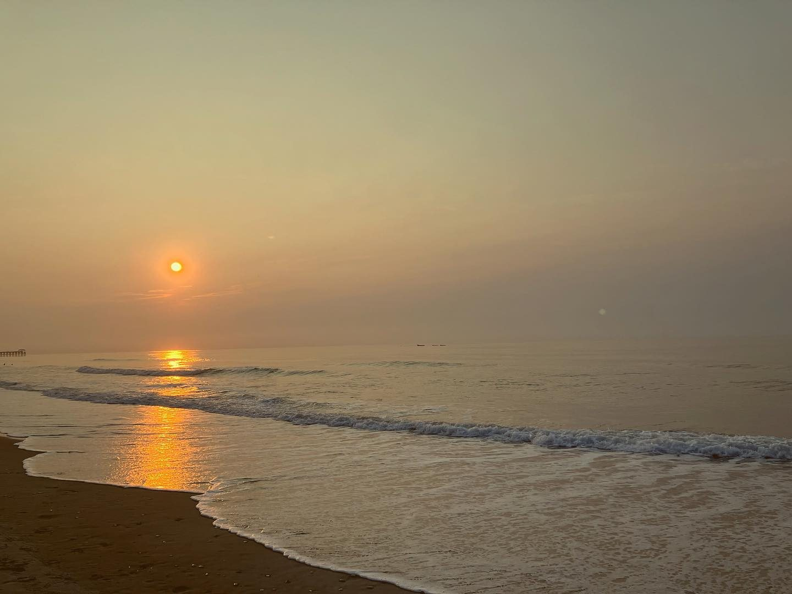

# T1 Research & Development

**Web & Media — Walton County, Georgia**




A 22-page static website for T1 Research & Development — home, about,
services, contact, and one page for each of the 18 services. All CSS
lives in `assets/site.css` and all JavaScript in `assets/site.js` —
no inline styling or scripting, no build step, no dependencies.

## ✨ Services

| Service | Price |
| ------- | ----- |
| Link-in-Bio Pages | $9/month |
| Personal Website | $35/month |
| Monthly Photo Refresh | $79–$149/month |
| Home Inventory for Insurance | $149 one-time + $9/month |
| Parental Controls & Safe Wi-Fi Setup | $99 one-time |
| Church & Sermon Media Hosting | $29–$49/month |
| Family Backup | $19/month per household |
| Tech Help House Calls | $49 per visit or $29/month |
| Family Security | $99 one-time + $9/month |
| Smart Home Setup | $99–$199 per visit |
| Cold Storage Archiving | $19–$29/month |
| Competitor Watch Report | $49/month |
| Digitizing & Archiving | Documents $199+/cabinet + $29/month · Photos $199–$499/box + $9/month |
| Business Backup | $39/month files + $39/month cloud apps |
| Secure Remote Access (VPN) | $39/month |
| Managed Game Servers | $19–$49/month per server |
| Security System Setup & Maintenance | Home $349–$549 setup + $29/month · Business $799–$1,499 setup + $79–$129/month |
| Photography | Contact for pricing |

Plus **website design & hosting**, our flagship — three plans on the
home page (Starter $349 + $49/mo · Standard $499 + $75/mo ·
Premium $749 + $99/mo).

## 📁 Structure

```
├── index.html            Home — hero, hosting tiers, services preview
├── about.html            About Brayden and T1 Research & Development
├── services.html         All 18 services, one card each
├── contact.html          Contact form with a service picker
├── services/             One page per service (18)
├── assets/
│   ├── site.css          The only stylesheet
│   └── site.js           The only script
├── images/               16 optimized @t1.research photos
├── sitemap.xml
└── robots.txt
```

## 👀 Viewing it locally

Open `index.html` in a browser, or serve the folder with any static
server (for example, `python3 -m http.server` from this folder, then
open http://localhost:8000). No build step — the files are the site.

## 📸 Photos

Every photo on this site is Brayden's own work from Instagram
[@t1.research](https://www.instagram.com/t1.research), optimized for
the web (hero 1440px, gallery 1200px, progressive JPEG).

## 📞 Contact

- **Phone:** [770-820-7364](tel:+17708207364)
- **Email:** [tasikxdevelopment@gmail.com](mailto:tasikxdevelopment@gmail.com)
- **Instagram:** [@t1.research](https://www.instagram.com/t1.research)
